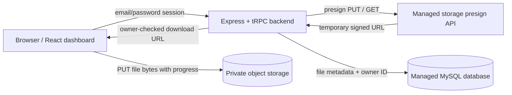

# Cloud Files

Cloud Files is a small, full-stack private file shelf: users create an account, upload files directly to private object storage, search and sort their personal file register, download through temporary signed links, and remove files from the app index.

## What is deployed

The app uses the initialized Manus Webdev managed project. It runs a React/Vite client and an Express/tRPC server backed by the managed MySQL-compatible database and the platform's private S3-backed object storage. No AWS account or AWS access keys are needed for the deployed version: the platform injects the storage and database credentials into the server runtime.

## Architecture



The editable source diagram is in [`docs/architecture.mmd`](docs/architecture.mmd).

## Security and signed URL flow

1. The user signs up or signs in with email and password. Passwords are salted and hashed with Node's built-in `scryptSync`; plaintext passwords are never persisted.
2. The server creates the starter-compatible `webdev_app_session` cookie. Protected tRPC procedures resolve the session to a database user before reading or mutating file records.
3. For an upload, the server validates the 50 MB limit, creates a server-owned key shaped like `users/{ownerId}/{uuid}-{safeFileName}`, requests a presigned PUT URL, and returns only that temporary URL to the browser.
4. The browser sends the file bytes directly to storage with `XMLHttpRequest`, so the application server does not proxy the file. The visible progress bar reflects that direct transfer.
5. After the PUT succeeds, the browser calls `completeUpload`. The server checks that the pending record, owner, and storage key match before marking metadata complete.
6. For a download, the server looks up the file by both file ID and current user ID. Only after that ownership check does it request and return a temporary signed GET URL.
7. The bucket/storage namespace is private. Stable storage paths are not used as public file links; the dashboard always requests a fresh signed URL.

## Folder structure

- `client/src/pages/Home.tsx` contains the login/sign-up screen and dashboard.
- `client/src/index.css` contains the responsive visual system.
- `server/routers.ts` contains auth, upload, download, list, and delete procedures.
- `server/db.ts` contains user and file metadata queries.
- `server/storage.ts` contains server-only presign calls.
- `drizzle/schema.ts` and `drizzle/0001_cloudy_black_panther.sql` contain the credential/file schema.
- `public/manus-routes.json` declares the web routes to the managed runtime.

## Local or self-hosted setup

Use Node 22+, pnpm 10.18+, a MySQL-compatible database, and a private S3-compatible object storage service if running outside Manus. Then:

```bash
pnpm install
pnpm db:migrate
pnpm dev
```

The server listens on `PORT` (default `3000`). For a production container, `pnpm build` creates the Vite client and bundled Express server, and `pnpm start` serves them.

## Required environment variables

The managed deployment supplies these values. In a self-hosted setup, provide equivalents through the environment, never by hardcoding them:

| Variable | Purpose |
| --- | --- |
| `DATABASE_URL` | MySQL-compatible metadata database connection string. |
| `MANUS_API_URL` | Managed runtime API base used for storage presigning. |
| `MANUS_API_KEY` | Server-only runtime credential used to request presigned storage URLs. |
| `MANUS_JWT_SECRET` | Platform-provided signing secret used by the starter-compatible application session cookie. |
| `MANUS_PROJECT_ID` | Platform project identifier included in the signed session. |
| `PORT` | HTTP listener port; defaults to `3000`. |

Do not expose `MANUS_API_KEY`, `DATABASE_URL`, or `MANUS_JWT_SECRET` in browser code. Only the browser-safe client bundle is public.

## Delete behavior

The managed runtime exposes presigned PUT/GET operations but no runtime object-delete operation. Cloud Files therefore performs a secure, owner-scoped soft delete: it marks the metadata row as deleted, removes it from search/listing, and removes its bytes from the user's visible storage usage. The object is not reachable through the application after deletion. An external S3 deployment can replace `softDeleteFile` with an owner-authorized physical delete call if retention policy requires it.

## Validation notes

The server exposes `/api/health`, and the browser route manifest is available at `/manus-routes.json`. The implementation is type-checked with `pnpm check`; the database migration is additive and is applied with `pnpm db:push` during project setup.

## Project report

The delivered project report is available as [`Cloud-Files-Project-Report.pdf`](Cloud-Files-Project-Report.pdf), with editable Markdown source in [`report/report.md`](report/report.md). It includes the aim, implementation procedure, architecture diagram, deployment checkpoint, and authenticated dashboard screenshot.
